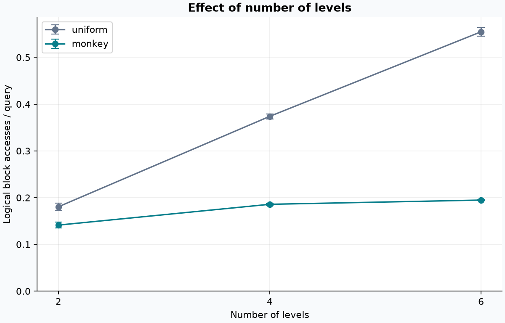

# Monkey: Optimizing Bloom Filter Memory Allocation

**DSC5003 Storing and Retrieving Data · Track 2 · Research Paper Replication**

DENG Tianyu, XIA Tianquan, ZHANG Yue, LI Wenhao, and ZHAO Yining

We reproduce the Bloom filter allocation method from *Monkey: Optimal Navigable Key-Value Store* (SIGMOD 2017) in a static Python implementation of a log-structured merge tree (LSM-tree). With 20,000 keys, four levels, a level-size ratio of 4, and a 12,500-byte filter budget, Monkey reduced mean logical page accesses per unsuccessful lookup from **0.36978 to 0.18668 (49.5%)** across ten seeds. [Paper](https://doi.org/10.1145/3035918.3064054) · [Multi-seed results](results/robustness_seeds/summary.csv)

[Quick start](#quick-start) · [Repository structure](#repository-structure) · [Experiments and datasets](#experiments-and-datasets) · [Correctness](#correctness-and-reproducibility) · [Method](#method) · [Results](#results) · [References](#references) · [中文导读](#chinese-summary)

## Quick start

### Install and test

Use **Git** and **Python 3.12**. The tests and CSV-only runs use the Python standard library and the pinned Git submodule. Install the locked dependencies to generate figures and HTML reports. The archived runs used Python 3.12.6 and Matplotlib 3.11.2 on macOS ARM64. [Dependency lock](requirements-lock.txt) · [Third-party code](THIRD_PARTY.md)

```bash
git clone --recurse-submodules https://github.com/kelnether/monkey-bloom-filter-replication.git
cd monkey-bloom-filter-replication
python3.12 -m venv .venv
.venv/bin/python -m pip install -r requirements-lock.txt
.venv/bin/python -m unittest discover -s tests -v
```

For an existing Git checkout, start at the repository root and run `git submodule update --init --recursive` before creating the environment. GitHub's source ZIP omits the submodule contents. In PyCharm, use the repository root as the working directory and select `.venv/bin/python` as the interpreter. You can skip the pip command for tests and runs with `--no-plots`.

### Run the default benchmark

```bash
run_dir=$(mktemp -d results/recheck.XXXXXX)
.venv/bin/python -m monkey_lab run --config configs/default.json --out "$run_dir/default"
```

Open the printed `report.html` path in a browser. The default suite produces **66 strategy records and 33 synthetic dataset snapshots**. Use a new or empty `--out` directory for each run. The CLI's built-in output path, `results/demo`, already contains an archived run, so pass `--out` explicitly.

### Run the robustness checks

Use the same `run_dir` from the default benchmark.

```bash
for config in robustness_seeds robustness_queries; do
  .venv/bin/python -m monkey_lab run \
    --config "configs/$config.json" --out "$run_dir/$config"
done
```

For a CSV-only run, append `--no-plots` to the `run` command. To generate or regenerate figures and HTML from the saved outputs, run `.venv/bin/python -m monkey_lab plot --out "$run_dir/default"` with the plotting dependencies installed.

## Repository structure

| Path | What to review |
| --- | --- |
| [`monkey_lab/allocation.py`](monkey_lab/allocation.py) | Uniform baseline, Monkey bisection, and Appendix C allocation |
| [`monkey_lab/bloom.py`](monkey_lab/bloom.py) and [`store.py`](monkey_lab/store.py) | Packed Bloom filters, static LSM-tree point lookups, and logical page-access counters |
| [`monkey_lab/__main__.py`](monkey_lab/__main__.py) and [`experiments.py`](monkey_lab/experiments.py) | CLI, seeded dataset generation, paired benchmarks, correctness checks, and result export |
| [`monkey_lab/model.py`](monkey_lab/model.py) and [`plotting.py`](monkey_lab/plotting.py) | Analytical cost model, parameter grid search, figures, and HTML reports |
| [`tests/test_core.py`](tests/test_core.py) | Unit and integration tests for the allocators, filtering and lookup, and reproducible experiments |
| [`configs/`](configs/) | Three runnable experiment suites |
| [`results/`](results/) | Saved synthetic datasets, measurements, predictions, figures, and run metadata |
| [`vendor/predictive-lsm-trees/`](vendor/predictive-lsm-trees) | Pinned reference code. [`upstream.py`](monkey_lab/upstream.py) loads its level-capacity helper. See [`THIRD_PARTY.md`](THIRD_PARTY.md) and [`upstream_manifest.json`](upstream_manifest.json) for provenance. |

## Experiments and datasets

The base case has 20,000 synthetic integer keys across four levels at ratio 4, five filter bits per key, up to 128 keys per page, and 5,000 unsuccessful lookups per seed. The default sweep varies one factor at a time. Each strategy within a scenario and seed uses the same level layout, query sequence, hash salts, and total filter budget.

| Configuration | What changes | Seeds | Saved run |
| --- | --- | --- | --- |
| [Default](configs/default.json) | Filter budget (0, 2, 5, 8, or 10 bits/key), level-size ratio (2, 4, or 10), levels (2, 4, or 6), and miss fraction (0%, 50%, or 100%) | 1–3 | [`results/final/`](results/final/) |
| [Seed comparison](configs/robustness_seeds.json) | Two, four, and six levels at five bits/key, plus four levels at two bits/key. Includes the Appendix C allocator. | 1–10 | [`results/robustness_seeds/`](results/robustness_seeds/) |
| [Query-count comparison](configs/robustness_queries.json) | 5,000 or 20,000 misses against the same data and filters within each seed | 1–3 | [`results/robustness_queries/`](results/robustness_queries/) |

[`workload()`](monkey_lab/experiments.py) generates the data from the configuration and seed. Each run writes one JSON snapshot per scenario and seed in `datasets/`. A snapshot contains `levels` (keys by level), `queries` (query key and expected membership), and `absent_probes` (keys used to measure per-level false-positive rates). In mixed workloads, the misses come from the saved absent-probe set. [Saved datasets](results/final/datasets/) · [Base-case snapshot](results/final/datasets/n20000_l4_t4_b5_m1_s1.json)

### Output files

| File or directory | Contents |
| --- | --- |
| [`config.json`](results/final/config.json) and [`metadata.json`](results/final/metadata.json) | Run configuration, Python and platform details, upstream revision, and core source SHA-256 fingerprints |
| [`experiments.csv`](results/final/experiments.csv) | Per-scenario, per-seed, per-strategy results, including filter bytes, dataset hash, logical accesses, correctness, and Python timings |
| [`levels.csv`](results/final/levels.csv) | Keys, allocated bytes, hash count, and measured and predicted false-positive rates by level |
| [`summary.csv`](results/final/summary.csv) | Means and sample standard deviations across seeds |
| [`model_search.csv`](results/final/model_search.csv) and [`best_configs.json`](results/final/best_configs.json) | Analytical grid candidates and the lowest-cost candidate for each strategy and write fraction |
| [`figures/`](results/final/figures/) and `report.html` | PNG and SVG figures and a local HTML report. Open the report from a clone to load the linked figures and CSVs. |

## Correctness and reproducibility

The 16 unit tests cover exact byte budgets, a small exhaustive allocation check, zero-budget filters, false negatives, page boundaries, query early exit, and repeated experiments. The benchmark verifies each inserted key against its filter and checks every point lookup against its saved label. For the same scenario and seed, compare `dataset_sha256` and `filter_payload_bytes` across strategies in `experiments.csv` to verify the pairing.

| Saved run | Strategy records | Dataset snapshots | Checked query executions |
| --- | ---: | ---: | ---: |
| [Default](results/final/experiments.csv) | 66 | 33 | 330,000 |
| [Seed comparison](results/robustness_seeds/experiments.csv) | 120 | 40 | 600,000 |
| [Query-count comparison](results/robustness_queries/experiments.csv) | 12 | 6 | 150,000 |
| **Total** | **198** | **79** | **1,080,000** |

All query answers matched the saved labels, and the filters returned zero false negatives on inserted keys. A Python 3.12 rerun reproduced all 79 dataset hashes and the non-timing experiment and model fields. Build and query timings vary with the machine and load. [`results/demo/`](results/demo/) and [`results/migration_check/`](results/migration_check/) are earlier default runs outside the totals above.

## Method

The replication implements the allocation objective in Section 4.1 and Appendix B, adapts the iterative solver in Appendix C, and uses the cost model in Section 4.2 for a separate analytical parameter search. The main benchmark runs static point lookups over in-memory pages, with one sorted run per level. It measures logical page accesses and filter payload bytes. The model estimates the costs of operations such as range queries and updates. [Original paper](https://cs-people.bu.edu/mathan/publications/sigmod17-dayan.pdf) · [Cost model](monkey_lab/model.py)

A lookup probes each run's packed Bloom filter. On a positive result, the run uses page boundary keys (fence pointers) to find and search one candidate page. A hit ends the lookup. A miss checks all levels, and every false positive adds one logical page access.

For a run with `n` keys, `m` filter bits, and `k` hash positions per key, the false-positive rate is approximated by `(1 - exp(-k*n/m))^k`. Using the continuous optimal hash count gives `p = exp(-(ln 2)^2 * m/n)`. A zero-byte filter always passes the lookup, giving `p = 1`. The expected miss cost sums these rates across runs.

| Strategy | Budget allocation |
| --- | --- |
| `uniform` | Assigns the same bits per key, up to whole-byte rounding. |
| `monkey` | Uses bisection to minimize the sum of continuous false-positive rates. Funded runs have equal `p/n` at the continuous optimum, so smaller runs receive more bits per key. The solver rounds down and assigns residual bytes by marginal gain. |
| `monkey_appendix_c` | Starts with the budget in the first run and tests transfers between pairs of runs. It keeps improving transfers with a positive donor balance and halves the step after a full pass without improvement. It finishes at a one-bit step, then uses the shared whole-byte rule. |

The filter uses a `bytearray`, deterministic SHAKE-256 hashing, and an integer hash count. Whole-byte rounding adjusts the continuous allocation to the byte budget. [Allocation code](monkey_lab/allocation.py) · [Filter code](monkey_lab/bloom.py) · [Query path](monkey_lab/store.py)

## Results

### Default benchmark

Across three seeds, mean logical page accesses fell from **0.37387 to 0.18580** in the base case, a **50.3%** reduction. The ten-seed result at the top of this README uses the same base configuration with seven additional seeds. [Default summary](results/final/summary.csv) · [Benchmark figures](results/final/figures/benchmarks.png)

| Level | Keys | Uniform bytes | Monkey bytes | Uniform false-positive rate | Monkey false-positive rate |
| ---: | ---: | ---: | ---: | ---: | ---: |
| 1 | 236 | 147 | 376 | 9.65% | 0.19% |
| 2 | 942 | 589 | 1,160 | 9.21% | 0.76% |
| 3 | 3,765 | 2,353 | 3,279 | 9.26% | 3.57% |
| 4 | 15,057 | 9,411 | 7,685 | 9.26% | 14.06% |

Monkey moves 1,726 bytes from the largest level to the three smaller levels. Their combined false-positive rate falls by about 23.61 percentage points, while the largest level's rate rises by 4.80 points. The net effect is about 0.18807 fewer logical page accesses per miss. A single lookup can trigger false positives at several levels. [Per-level records](results/final/levels.csv)

| Levels | Uniform mean ± SD | Monkey mean ± SD | Paired difference mean ± SD | Reduction |
| ---: | ---: | ---: | ---: | ---: |
| 2 | 0.18047 ± 0.00753 | 0.14133 ± 0.00605 | 0.03913 ± 0.01245 | 21.7% |
| 4 | 0.37387 ± 0.00533 | 0.18580 ± 0.00193 | 0.18807 ± 0.00530 | 50.3% |
| 6 | 0.55473 ± 0.00965 | 0.19480 ± 0.00100 | 0.35993 ± 0.01051 | 64.9% |

The level-count sweep holds the key count, size ratio, filter bytes, and all-miss workload fixed. Each paired difference subtracts the Monkey value from the uniform value for the same seed. [Per-seed records](results/final/experiments.csv)



- With no filter budget, a miss reads one page at each of the four levels. At 2, 5, 8, and 10 bits per key, the relative reductions were 49.1%, 50.3%, 50.4%, and 51.6%.
- As the level-size ratio rose from 2 to 4 to 10, the reduction rose from 21.7% to 50.3% to 63.5%. At a larger ratio, the same extra byte provides more bits per key in the smaller levels.
- At miss fractions of 0%, 50%, and 100%, the reductions were 17.5%, 25.1%, and 50.3%. A hit includes a read of the page containing the key and can skip later levels. [Budget, ratio, and miss-fraction plots](results/final/figures/benchmarks.png)

In the base case, the integer-hash-count model predicts **0.36800** accesses for uniform allocation and **0.18712** for Monkey. The absolute differences from measurement are about **0.00587** and **0.00132**, respectively. The formula approximates bit occupancy, while the benchmark probes the actual filters with 5,000 miss keys per seed. [Model comparison](results/final/figures/model_check.png)

### Seed and query-count checks

The ten-seed runs use 5,000 misses per seed, 20,000 keys, and a level-size ratio of 4. The columns below report mean logical accesses per query.

| Levels | Bits/key | Uniform | Monkey bisection | Appendix C | Paired difference mean ± SD | Reduction |
| ---: | ---: | ---: | ---: | ---: | ---: | ---: |
| 2 | 5 | 0.18170 | 0.14586 | 0.14586 | 0.03584 ± 0.00980 | 19.7% |
| 4 | 5 | 0.36978 | 0.18668 | 0.18668 | 0.18310 ± 0.00671 | 49.5% |
| 6 | 5 | 0.55948 | 0.19254 | 0.19254 | 0.36694 ± 0.01741 | 65.6% |
| 4 | 2 | 1.57348 | 0.79816 | 0.79816 | 0.77532 ± 0.03111 | 49.3% |

In the four-level, five-bit case, the paired difference was positive for every seed, ranging from 0.1712 to 0.1934. Both Monkey solvers assigned 376, 1,160, 3,279, and 7,685 bytes in the base case, with a continuous objective of about 0.18677. Their whole-byte allocations and measured access counts matched in all four tested configurations. [Seed-level records](results/robustness_seeds/experiments.csv) · [Per-level records](results/robustness_seeds/levels.csv)

The query-count check keeps the data, per-level budget, hash salts, and hash counts fixed within each seed. Each short trial uses the first 5,000 queries of the corresponding 20,000-query trial. The samples share that prefix. The standard deviations describe variation across three seeds, including changes in data and filter salt.

| Miss queries per seed | Uniform mean ± SD | Monkey mean ± SD | Reduction |
| ---: | ---: | ---: | ---: |
| 5,000 | 0.37260 ± 0.01226 | 0.18660 ± 0.00597 | 49.9% |
| 20,000 | 0.36980 ± 0.00201 | 0.18703 ± 0.00520 | 49.4% |

[Multi-seed summary](results/robustness_seeds/summary.csv) · [Query-count plot](results/robustness_queries/figures/query_count.png) · [Query-count summary](results/robustness_queries/summary.csv)

### Analytical parameter search

The model combines predictions for unsuccessful lookups, hits at the deepest run, range queries, and amortized updates. Its separate 128,000-byte budget covers the write buffer and filters, excluding fence pointers. The workload weights sum to one, and range queries have zero weight in the default search.

The grid evaluates 144 candidates using 100,000 entries at 128 bytes each and 4,096-byte pages. It crosses level-size ratios of 2, 4, 8, and 10, buffer shares of 5%, 20%, and 50%, leveling and tiering, both default filter strategies, and three write fractions. For Monkey at 10% and 50% writes, the lowest predicted costs use leveling at ratio 2 with buffer shares of 5% and 20%, respectively. At 90% writes, the selected candidate uses tiering at ratio 8 with a 20% buffer share. The search uses the model and this finite grid. The benchmark itself runs static point lookups. [Cost model](monkey_lab/model.py) · [Candidate CSV](results/final/model_search.csv) · [Grid winners](results/final/best_configs.json)

## References

1. Niv Dayan, Manos Athanassoulis, and Stratos Idreos. 2017. *Monkey: Optimal Navigable Key-Value Store*. SIGMOD, 79–94. The replication uses the allocation objective in Section 4.1, the cost model in Section 4.2, and Appendices B and C. [DOI](https://doi.org/10.1145/3035918.3064054) · [Author PDF](https://cs-people.bu.edu/mathan/publications/sigmod17-dayan.pdf).
2. Zichen Zhu, Yanpeng Wei, Ju Hyoung Mun, and Manos Athanassoulis. 2025. *Mnemosyne: Dynamic Workload-Aware BF Tuning via Accurate Statistics in LSM trees*. PACMMOD 3(3), Article 190 (SIGMOD 2025). Covers dynamic filter reallocation and access statistics. [DOI](https://doi.org/10.1145/3725327) · [Author PDF](https://cs-people.bu.edu/mathan/publications/pacmmod25-zhu.pdf).
3. Niv Dayan and Stratos Idreos. 2018. *Dostoevsky: Better Space-Time Trade-Offs for LSM-Tree Based Key-Value Stores via Adaptive Removal of Superfluous Merging*. SIGMOD, 505–520. Covers the effect of merge policy on read, update, and space costs. [DOI](https://doi.org/10.1145/3183713.3196927) · [Author PDF](https://nivdayan.github.io/dostoevsky.pdf).
4. Russell Sears and Raghu Ramakrishnan. 2012. *bLSM: A General Purpose Log Structured Merge Tree*. SIGMOD, 217–228. Background on LSM design and merge scheduling. [DOI](https://doi.org/10.1145/2213836.2213862) · [Public proceedings copy](https://awoc.wolski.fi/dlib/access-methods/SR12-bLSM.pdf).
5. Manos Athanassoulis, Michael S. Kester, Lukas M. Maas, Radu Stoica, Stratos Idreos, Anastasia Ailamaki, and Mark Callaghan. 2016. *Designing Access Methods: The RUM Conjecture*. EDBT, 461–466. Frames the trade-offs among reads, updates, and memory or storage. [DOI](https://doi.org/10.5441/002/EDBT.2016.42) · [Proceedings PDF](https://www.openproceedings.org/2016/conf/edbt/paper-12.pdf).

[LevelDB](https://github.com/google/leveldb) was the basis of the paper's system experiments. [RocksDB](https://github.com/meta/rocksdb) is a related LSM-based engine. See [THIRD_PARTY.md](THIRD_PARTY.md) for the pinned Python reference and the exact reuse in this project.

## Chinese summary

本项目用 Python 复现 Monkey 的分层 Bloom filter 内存分配。在相同的 12,500 字节过滤器预算下，十个随机种子的基础实验中，未命中查询的平均逻辑页访问数从 0.36978 降至 0.18668，下降 49.5%。仓库包含核心算法、测试、可生成的合成数据和评估脚本。[安装和运行](#quick-start) · [代码结构](#repository-structure) · [实验与数据](#experiments-and-datasets) · [实验结果](#results)
