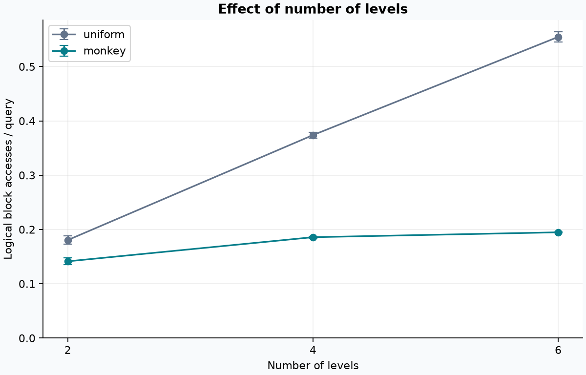

# Monkey 复跑结果与交付核对

在 20,000 个键、4 层、层大小比例 T=4、平均 5 bits/key、全部查询未命中的基础场景中，两种策略各用 12,500 字节过滤器载荷。Monkey 分配将每次查询的平均逻辑页访问数从 **0.37387 降至 0.18580**，降幅 **50.3%**。[实验报告](../results/final/report.html) · [汇总 CSV](../results/final/summary.csv)

## 为什么会少访问数据页

当键在所有层都不存在时，当前查询路径会检查所有层的过滤器。每次误报触发一次逻辑页访问，因此每层误报率之和就是每次未命中查询的期望访问数。这个期望关系只需要把各层的访问指示量相加。

| 层 | 键数量 | 统一预算（字节） | Monkey 预算（字节） | 统一误报率 | Monkey 误报率 |
|---|---:|---:|---:|---:|---:|
| 1 | 236 | 147 | 376 | 9.65% | 0.19% |
| 2 | 942 | 589 | 1,160 | 9.21% | 0.76% |
| 3 | 3,765 | 2,353 | 3,279 | 9.26% | 3.57% |
| 4 | 15,057 | 9,411 | 7,685 | 9.26% | 14.06% |

表中误报率取三个种子的均值。Monkey 从最大层转出 **1,726 字节**，使前三层的误报率之和下降约 **23.61 个百分点**，最大层上升 **4.80 个百分点**。两部分相加，平均每次查询减少约 **0.18807 次逻辑页访问**。各层误报率之和可大于单个概率，因为一次查询可能触发多次误报。[逐层记录](../results/final/levels.csv)

## 层数与其他参数怎样影响收益

层数对比固定总键数 20,000、T=4、过滤器总预算 12,500 字节、未命中比例 100%。每个种子对两种策略使用同一份数据和查询，每次执行 5,000 次查询。图上误差线为三个种子的样本标准差。



| 层数 | 统一分配均值 ± 标准差 | Monkey 均值 ± 标准差 | 配对差值均值 ± 标准差 | 相对降幅 |
|---:|---:|---:|---:|---:|
| 2 | 0.18047 ± 0.00753 | 0.14133 ± 0.00605 | 0.03913 ± 0.01245 | 21.7% |
| 4 | 0.37387 ± 0.00533 | 0.18580 ± 0.00193 | 0.18807 ± 0.00530 | 50.3% |
| 6 | 0.55473 ± 0.00965 | 0.19480 ± 0.00100 | 0.35993 ± 0.01051 | 64.9% |

配对差值先在同一个种子上计算“统一分配 − Monkey”，再跨种子汇总。相对降幅用两种策略的均值计算。统一分配让各层的每键位数接近，增加一层通常会增加一份相近的误报开销。Monkey 压低较小层的误报率，所以在测试的 2–6 层区间内，访问数增长较慢。表中的标准差描述这三个种子的波动。

- **过滤器预算**：零预算时四层都要检查，两种策略均为 4 次访问。预算为 2、5、8 和 10 bits/key 时，基础布局下的相对降幅为 49.1%、50.3%、50.4% 和 51.6%。
- **层大小比例**：T 从 2、4 增至 10 时，相对降幅分别为 21.7%、50.3% 和 63.5%。较大的 T 拉大了层间键数的差异，同样的额外空间给较小层时能增加更多每键位数。
- **未命中比例**：未命中比例为 0%、50% 和 100% 时，相对降幅分别为 17.5%、25.1% 和 50.3%。命中查询包含一次找到键的访问，也会在找到键时提前结束，这两点都会改变相对降幅。

[总览图](../results/final/figures/benchmarks.png) · [层数图 SVG](../results/final/figures/level_count.svg) · [逐次实验](../results/final/experiments.csv)

## 理论预测与实测

基础场景下，使用实际整数哈希数的误报模型预测统一分配和 Monkey 分别为 **0.36800** 和 **0.18712** 次访问／未命中查询，与实测相差约 **0.00587** 和 **0.00132**。预测使用近似误报公式，实测来自每个种子的 5,000 个未命中键；有限样本和过滤器的实际置位情况都会带来偏差。连续分配模型还采用连续哈希数近似，两个预测值可在汇总表中分别比较。[模型核对图](../results/final/figures/model_check.png)

独立的参数搜索枚举了 **144 个候选配置**。以 Monkey 分配为例，写入比例为 10% 和 50% 时，网格内最低预测成本的配置都采用 leveling、T=2，缓冲区比例分别为 5% 和 20%。写入比例为 90% 时，结果为 tiering、T=8、缓冲区比例 20%。静态实验在内存中执行点查询。写入、范围查询和合并的成本由模型估算，默认搜索的范围查询权重为 0。[候选 CSV](../results/final/model_search.csv) · [分组最优配置](../results/final/best_configs.json)

## 复跑及版本核对

2026-11-21 从本地仓库 `e14ac7a` 干净克隆，检出固定版本的上游子模块，加入绘图与报告更新后执行默认实验。运行环境为 macOS ARM64、Python 3.12.6、Matplotlib 3.11.2。

| 核对项 | 结果 |
|---|---|
| 测试 | 14 项通过，覆盖预算、零预算、无漏判、查询路径和模型搜索 |
| 查询和配对 | 66 条策略运行记录，共核对 330,000 次查询答案，均正确；已插入键漏判数为 0；33 组配对均共享数据和预算 |
| 历史对照 | 33 个数据快照逐字节一致；66 条记录的所有非计时字段、逐层统计、汇总及 144 个理论候选均与 `migration_check` 一致 |
| 交付文件 | 快照配置与默认配置一致；`metadata.json` 的 9 个源码 SHA-256 和固定子模块提交均与运行版本一致；HTML 引用的图表及数据文件均可找到 |

已有 Python 环境或按 README 安装依赖后，在项目根目录运行：

```bash
.venv/bin/python -m unittest discover -s tests -v
run_dir="results/recheck_$(date +%Y%m%d_%H%M%S)"
MPLCONFIGDIR="$PWD/.mplconfig" XDG_CACHE_HOME="$PWD/.cache" \
  .venv/bin/python -m monkey_lab run --config configs/default.json --out "$run_dir"
```

用新的 `summary.csv` 对照已保存的汇总。若核对逐次记录，构建和查询耗时会随机器及负载变化。项目记录的内存预算是过滤器位数组载荷，页访问计数对应静态逻辑页。

[运行配置](../results/final/config.json) · [源码与环境指纹](../results/final/metadata.json) · [README](../README.md)
